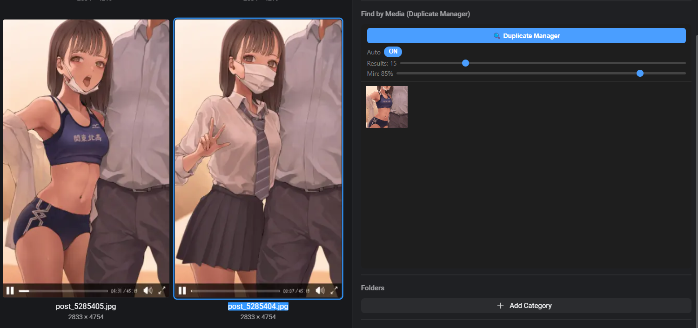
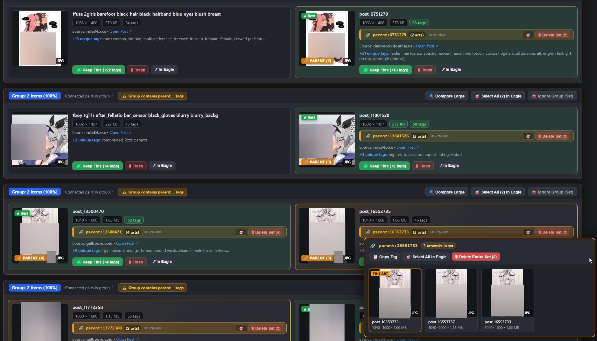

# eagle-cool-find-by-media-modded

An inspector plugin for [Eagle](https://eagle.cool). It shows images from your library that look like the selected one, and its separate **Duplicate Manager** window finds and cleans up duplicates across the whole library. Everything runs offline on your machine.

> **This plugin is designed to work with [booru-to-eagle-cool-saver](https://github.com/JennethBlackray/booru-to-eagle-cool-saver).**
> That extension saves artworks from booru sites into Eagle with their tags, source link and a shared `parent:<id>` tag for related images. The Duplicate Manager uses this data: it shows the source site, protects `parent:...` sets and merges tags when you keep one copy.
> It also works without the extension, but the `parent:...` features stay inactive.

> **This is a modified fork of [find-by-media](https://github.com/burakgobut/find-by-media).**
> Big thanks to its author, [burakgobut](https://github.com/burakgobut), for the original plugin: the neural search, the hashing and the inspector panel all come from that project. This fork adds the Duplicate Manager, `parent:...` support and automatic indexing of images added while Eagle is running.

## Installation

1. Download this repository (**Releases**) and unpack it to any folder.
2. Download the AI model [mobilenetv2-7.onnx](https://github.com/onnx/models/raw/main/validated/vision/classification/mobilenet/model/mobilenetv2-7.onnx) (~14 MB) and put it in the `models` folder inside the unpacked folder. This step is optional: without the model the plugin only compares pixels and colors.
3. In Eagle, click the **Plugin** button on the toolbar and choose **Developer Options**.
4. Click **Import Local Project** and select the unpacked folder (the one that contains `manifest.json`).
5. Select any image in your library. A **Find by Media (Duplicate Manager)** section appears in the right-hand panel (the inspector).

The first start indexes the whole library in the background, and a progress bar shows how far it has got. After that, images you add to Eagle are indexed on their own within a few seconds, so you don't need to restart.

### Inspector panel

  

| Action | Result |
|---|---|
| Select an image in Eagle | Show similar images (when **Auto** is on) |
| Click a result | Open a large preview |
| Double-click a result | Go to that image in Eagle |
| Click the preview / `Esc` | Close the preview |
| Double-click the preview | Go to that image in Eagle |
| Drag an image file onto the panel | Search the library for images like that file |
| **🔍 Duplicate Manager** | Open the Duplicate Manager window |

| Control | What it does |
|---|---|
| **Auto** | Turn automatic search on selection on or off |
| **Results** | How many similar images to show |
| **Min** | Minimum similarity in percent |

## Duplicate Manager window controls

Open the window with the **🔍 Duplicate Manager** button in the inspector panel.

  

### Image cards

| Action | Result |
|---|---|
| Click a thumbnail | Open the large comparison view |
| Middle-click a thumbnail | Open the image in a new Eagle window |
| **✅ Keep This** | Keep this copy, move the other copies to the Eagle Trash and merge their tags, folders, source link, notes and rating into it |
| **🗑 Trash** | Move this copy to the Eagle Trash |
| **↗ In Eagle** | Show the image in Eagle |
| **Open Post ↗** | Open the source page in the browser |
| `parent:...` badge | Show the whole set: **Copy Tag**, **Select All in Eagle**, **Delete Entire Set** |

**★ Best** marks the copy with the best quality: higher resolution first, then a lossless format (PNG over WEBP over JPG), then a bigger file, then more tags.

In **Groups** mode each group also has **Compare Large**, **Select All in Eagle** and **Ignore Group (Set)**.

### Comparison view

| Keys / action | Result |
|---|---|
| `←` / `→` | Previous / next pair |
| `Space` | Switch between the two images in **Overlay Blink** mode |
| Double-click / click (Overlay Blink) | Switch between the two images |
| Mouse wheel | Zoom both images together |
| Drag | Move the zoomed images |
| `Esc` | Close the comparison view |

The **1:1 Reset Zoom** button resets the zoom. Buttons at the bottom: **Keep Left / Keep Right** (with tag merging), **Trash Left / Trash Right**, **↗ In Eagle** and **🙈 Not Duplicate (Ignore Pair)**.

### Toolbar

- **Similarity** — the minimum similarity, typed in or picked with a preset (**100%**, **≥98%**, **≥95%**, **≥90%**).
- **Mode** — **Pairs** shows each pair separately; **Groups (Sets)** joins connected images into groups.
- **Sort by** — similarity, `parent:...` tags first, resolution difference, different formats, tag count difference or file size.
- **🔄 Rescan Library** — look for new images and scan the library again.
- **⚡ Auto-Cleanup** — clean up the shown pairs automatically: keep the best copy, merge tags and move the rest to the Trash. You choose the minimum similarity, and pairs with `parent:...` tags can be skipped so you can review them yourself.

### Filters

- **Same aspect ratio** — hide pairs where one image is portrait and the other is landscape.
- **Ignore same `parent:...` tag** — hide pairs from the same `parent:...` set.
- **Hide artist variation sets** — hide variations by the same artist (same site, same resolution, under 99.5% similarity).
- **Diff format / resolution only** — show only pairs whose files differ in format or resolution.
- **Strict contours** — compare mostly by shapes (85%) and less by colors (15%).

Pairs you mark as **Not Duplicate** are hidden and counted in the stats line under the toolbar; **Reset** brings them back.

## Credits

- [burakgobut](https://github.com/burakgobut) — author of the original [find-by-media](https://github.com/burakgobut/find-by-media) plugin this fork is based on.
- Built with [ONNX Runtime](https://onnxruntime.ai/) and [MobileNet V2](https://github.com/onnx/models/tree/main/validated/vision/classification/mobilenet).

MIT License, see [LICENSE](LICENSE).
